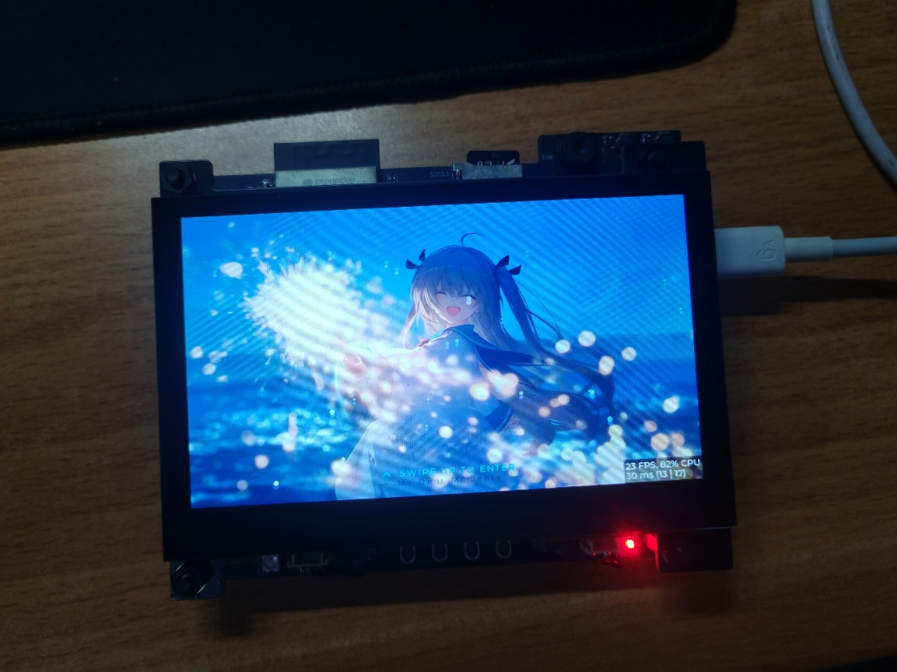
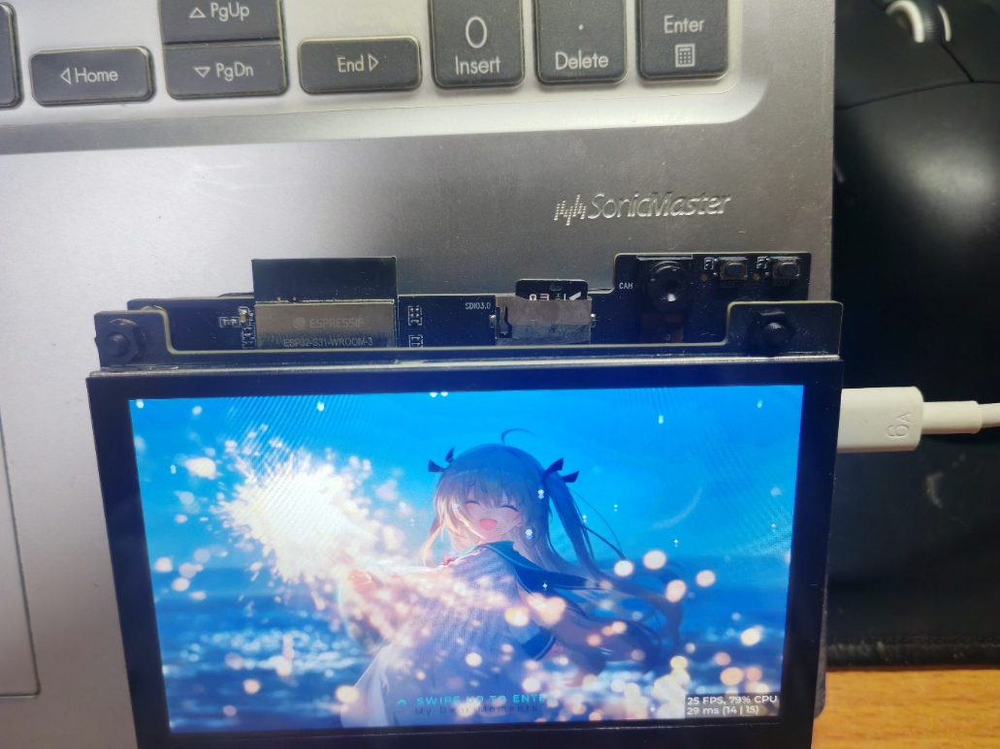

# 桌宠伴侣 · pet_companion

<p>
  
  
  
  
  
  
  
  
</p>

> 一台会说话、会看、会动手的桌面机器人。
> **ESP32-S31 负责身体**（感知 / 表达 / 执行），**云端负责智力**（听 / 想 / 说 / 记）。
> 两端只隔**一条 WebSocket 长连接** —— 设备永远主动外连，所以云端能穿透 NAT 精确指挥它。

<p>
  
  
</p>

本文件回答三个问题：**云端到底实现了什么、设备到底实现了什么、云端大肥鱼（AstrBot）是怎么接进这块 ESP32 的**。
更细的分层设计、时序与踩坑复盘见 [架构分析](docs/开发文档/架构分析.md)、[云端网关开发文档](docs/开发文档/S9_云端网关_开发文档.md)。

**目录** · [系统全景](#1-系统全景) · [云端做了什么](#2-云端服务器实现了什么) · [设备做了什么](#3-边缘设备实现了什么) ·
[大肥鱼怎么接进来的](#4-大肥鱼astrbot-是怎么接进-esp32-的) · [端云契约](#5-端云契约11-种帧) ·
[快速开始](#6-快速开始) · [仓库地图](#7-仓库地图) · [关键约束](#8-关键约束违反就炸) · [排障与文档](#9-排障与文档)

---

## 1. 系统全景

```
┌─ 云端 · 智力 ───────────────────────────────────────────────────────────────┐
│  L4 内容   music_proxy :8080（网易云 + 2 兜底源）· alist :5244              │
│  L3 智力   LLM deepseek-flash · ASR SenseVoiceSmall · TTS qwen-audio-3.1    │
│            VL 多模态看图 · embedding 记忆检索                               │
│  L2 编排   AstrBot v4.29.1（人格「大肥鱼」+ 插件体系）                       │
│  L1 接入   pet-gateway :8081（唯一入口 / 工具中继 / 媒体归一化）             │
└──────────────────────────────▲──────────────────────────────────────────────┘
                               │  一条 WebSocket 长连接（设备主动外连）
                   上行 text/pcm/caps/action_result/barge_in
                   下行 text/emotion/audio/image/action/system/error
┌──────────────────────────────┴──────────────────────────────────────────────┐
│  L5 表达   LVGL 桌宠浮窗 · 6 个 tab（CAM/VIDEO/FILES/MUSIC/REC/SYS）        │
│  L4 会话   xiaozhi_service：状态机 + codec 租借 + 双播放通道（TTS 抢占）     │
│  L3 执行   ai_action + 6 个业务模块：15 个 MCP 工具 + 1 个纯本地动作         │
│  L2 解码   event_bus：7 种下行帧分发（收包线程只入队，绝不阻塞）            │
│  L1 传输   ws_client：单连接 + 1s→30s 指数退避 + 按 JSON 括号切帧            │
│  身体      ESP32-S31 RISC-V @240MHz · 16MB Flash + 8MB PSRAM · 800×480 屏    │
└─────────────────────────────────────────────────────────────────────────────┘
```

一句话概括分工：**设备负责"在场"，云端负责"理解"**。设备端**不跑任何大模型**（连 ASR 都不跑），
唯一例外是人脸检测/识别两个小模型 —— 那是隐私、时延、离线可用性三者共同逼出来的。

---

## 2. 云端服务器实现了什么

云端不是"一个大模型"，而是**四层能力栈 + 一个必须存在的网关**。全部接口已实测在线
（`GET /health` 返回 `version 0.8.1`）。

### 2.1 四层能力栈

| 层 | 组件 | 实际职责 |
|---|---|---|
| **L4 内容** | `music_proxy`（Docker :8080） | 点歌音源代理：自建网易云 API + gdstudio / qijieya 两个兜底源；契约 `GET /v1/search · /v1/url · /v1/lyric · /v1/pic · /v1/download`。设备本地曲库未命中时由它兜底 |
| | `alist`（:5244） | 表情包、素材的检索后端 |
| **L3 智力** | LLM `deepseek-flash` | 对话、人格、决定"该调哪个工具" |
| | ASR `SenseVoiceSmall` | OpenAI 兼容 `/audio/transcriptions`，16k mono WAV |
| | TTS `qwen-audio-3.1-tts-flash` | 少女音，WAV 24 kHz；流式 WAV 需重写头（否则播放器读成 4 万秒） |
| | VL（多模态消息段） | 把设备上行的 JPEG 作为 image 段塞进 LLM = 看图回答 |
| | Embedding | 长期记忆、表情包语义检索 |
| **L2 编排** | AstrBot v4.29.1（容器 :6185） | 人格「大肥鱼」+ 插件体系：`pet_device`（工具注册）· `livingmemory`（记忆）· `omnidraw`（生图）· `music` · `proactive_chat`（主动关怀）… |
| **L1 接入** | `pet-gateway`（FastAPI :8081，systemd） | 设备唯一长连接、工具中继、媒体归一化、主动推送。`MemoryMax=256M` 防 OOM 拖垮宿主 |

### 2.2 网关对外只有 7 个入口

| 入口 | 方向 | 作用 |
|---|---|---|
| `WS /ws/{session_id}` | 设备 ↔ 云 | 唯一长连接，收发全部 JSON 帧 |
| `POST /upload/{session_id}` | 设备 → 云 | 上传原始 JPEG（≤4 MB）换 `attachment_id`，再走看图；**不进 `/static`**，只给云端看 |
| `POST /action` | 插件 → 设备 | 工具中继：把动作转成 WS `action` 帧并**同步等回执** |
| `GET /caps` | 插件 ← 设备 | 查设备自述的能力表（工具名 / 描述 / 参数 / 别名） |
| `POST /push` | 插件 → 设备 | 主动推送（"该睡觉了"）：`emotion → text →（可选）audio` |
| `GET /media/{name}` | 设备 ← 云 | AstrBot 产出的图片/语音出口（AstrBot 的 SSE 只给文件名，设备只会按 URL 取） |
| `GET /health` | 运维 | `{"ok":true,"tts":true,"stt":true,"sessions":…,"caps":…}` |

### 2.3 云端替设备扛下的三件事

1. **媒体归一化**：云端插件产出 GIF(500×500) / PNG(1024×1024)，设备的硬件 JPEG 解码器只吃
   baseline-DCT、≤1M 像素、≤1200KB ⇒ 网关 `normalize_image()` 用 Pillow 转 RGB、等比缩、重编码，
   设备端**零改动**。
2. **降级兜底**：TTS 挂了只掉语音、文字照发；AstrBot 重启时网关重试一次；模型回复超长时
   `tts_shorten()` 截到 200 字，**屏幕上仍是全文**；图片不合规就转码而不是丢弃。
3. **零新密钥复用语音能力**：网关启动时直读 `/opt/astrbot/data/cmd_config.json`，自动拿到
   AstrBot 已配好的 TTS/STT provider。换音色、换 ASR 模型只在 AstrBot 面板改一次，
   **网关与设备零感知**。

---

## 3. 边缘设备实现了什么

### 3.1 16 个可被云端调用的能力

设备把工具表**自己报给云端**（caps），因此"设备会什么"的唯一真相在固件里。

| 模块 | 工具（MCP 名） | 用户说法 |
|---|---|---|
| `camera` | `self.camera.capture` · `self.camera.explain` | "拍张照" / "看看这是什么" |
| `punch` | `self.punch.clock_in` | "打个卡"（人脸识别 + 存照 + 记考勤） |
| `music` | `self.music.play` · `stop` · `list` · `download` | "放首晴天"（本地曲库优先，未命中走云端音源） |
| `speaker` | `self.speaker.set_volume` · `get_volume` | "大点声"（相对调整，不编绝对值） |
| `light` | `self.light.set_power` · `set_brightness` · `set_rgb` · `get_state` | "灯调暖一点" |
| `device` | `self.device.reboot` · `self.wifi.get_status` | "重启一下" / "Wi-Fi 怎么样" |
| 本地 | `wallpaper`（MCP 引擎里没有，纯本机动作） | "换个壁纸" |

> 15 个来自 MCP 引擎 `tools/list`，`wallpaper` 由 `ai_action.c` 补报，合计 **16 个**。
> 屏幕上的快捷 chip 只取 `chip=true` 的 6 个 —— 800 px 排不下 16 个，台灯/Wi-Fi 本来就该用嘴说。

### 3.2 边缘端五级链路

`main/middleware/ai/` 是整条端云链路的落点，任何一次改动都能定位到其中一级：

| 级 | 文件 | 职责 | 关键约束 |
|---|---|---|---|
| ① 传输 | `ws_client.c` | 唯一长连接、1s→30s 指数退避、按 JSON 大括号配对切帧 | 不按 `\n` 也不按 fin 切（网关会连续多帧、TCP 还会合并） |
| ② 解码 | `event_bus.c` | 7 种下行帧分发：text / emotion / audio / image / action / system / error | 收包任务里**只入队不阻塞** |
| ③ 执行 | `ai_action.c` + 6 模块 | 动作队列 worker（栈 7168 B）：参数模板合并 → 直调或 `tools/call` → 回 `action_result` | 表里没有的动作**当场报错**，不空转一圈 |
| ④ 会话 | `xiaozhi_service.c` | 会话状态机 + codec 独占租借 + 双播放通道：TTS `pri=2` 抢占、音乐 `pri=1` 让位 | TTS 结束自动续播音乐，用户听不出被切断 |
| ⑤ 表达 | `ui/` | `pet_overlay` 桌宠浮窗 + 6 个 tab + 全 CJK bin 字体 | **只有 LVGL 线程能碰 LVGL**，其它任务只置 `volatile` 标志 |

### 3.3 端侧智能：为什么人脸必须留在本地

| 能力 | 模型 | 体量 | 耗时 | 为什么不上云 |
|---|---|---|---|---|
| 人脸检测 | `espdet_pico_224_face` | ~300 KB | < 100 ms | 取景框要实时画框，往返云端不可能 |
| 人脸识别 | MFN + MSR + MNP | 1.30 MB + 60 KB + 127 KB | **324 ms/次** | 人脸特征不出设备 = 隐私；断网也能打卡 |
| 手势识别 | hand_detect / hand_gesture | ~200 KB | 实时 | 同上 |

人脸库 `face_db` 落在 SD 卡：**双世代号 + CRC**，掉电不丢、写坏可回退上一代。

### 3.4 纯端侧、断网也能用的功能

| 功能 | 实现 |
|---|---|
| 本地音乐 | SD 卡 mp3 列表、同名 `.lrc` 三行歌词、进度拖动、上下曲、后台播放 |
| 蓝牙外放 | A2DP Source（SBC），连上音响后音乐改由蓝牙出声，可后台继续；controller **懒上电** |
| 录像 / 录音 | AVI 封装、ES8389 录音，全部落 SD |
| 文件管理 | FILES 页浏览 / 删除 / 播放；点 `.mp3` 自动切 MUSIC 起播 |
| 动态壁纸 | 本地壁纸池定时轮换，断电记忆 |
| 网页管理端 | Wi-Fi APSTA 常开热点 + `:80` 单页（20 个 API），手机直连改配置 |

<p>
  
</p>

### 3.5 硬件与分区

| 项 | 规格 |
|---|---|
| SoC | ESP32-S31（RISC-V @ 240 MHz，双核 SMP） |
| 内存 | 16 MB Flash + 8 MB PSRAM（OCT @ 200 MHz） |
| 显示 | 800×480 RGB LCD，双帧缓冲 + LVGL，GT1151 电容触摸 |
| 摄像头 | OV3660（DVP 8-bit）：1280×720 JPEG / 240×240 RGB565 |
| 音频 | ES8389 codec；录音 16 kHz mono，播放 16 kHz stereo |
| 存储 | microSD（FATFS）：`/music` `/photos` `/wallpaper` `/face_db` `/attendance` |
| 联网 | Wi-Fi APSTA（STA 联网 + 常开热点） |

| 分区 | 偏移 | 大小 | 说明 |
|---|---|---|---|
| `ota_0` | `0x20000` | `0x7C0000`（7.75 MB） | 唯一 app 槽 |
| `storage` | `0x7E0000` | `0x820000`（8.12 MB） | littlefs：模型 / 字体 / 图标 / 素材 |

> 单 app 槽 ⇒ **OTA 实质失效**，回退手段就是 USB 全量烧录。改分区表后必须重烧 `storage.bin`。

---

## 4. 大肥鱼（AstrBot）是怎么接进 ESP32 的

这是整套系统最容易被问"到底怎么连的"部分。结论先给：**设备不从 AstrBot 拿任何东西，
设备只连 pet-gateway；由网关去和 AstrBot 说 AstrBot 的语言。**

### 4.1 接入拓扑

```
        ┌──────────────────────── 云服务器 ────────────────────────┐
        │  AstrBot 容器 :6185  ← /api/v1/chat (SSE, Bearer abk)     │
        │      ▲                         ▲                          │
        │      │ provider 配置直读        │ 插件 POST /action /push   │
        │  pet-gateway :8081 ─────────────┘                          │
        │      ▲  GET /media、/static（图片 / TTS 音频）              │
        └──────┼──────────────────────────────────────────────────────┘
               │  WS /ws/xz-s31-<MAC末4位>
               │  ↑ text / pcm / caps / action_result / barge_in
               │  ↓ text / emotion / audio / image / action / system / error
        ┌──────┴────── ESP32-S31 ────────┐
        │  ws_client → event_bus → ai_action → 硬件   │
        └────────────────────────────────┘
```

三段职责各一句：

- **AstrBot = 大脑**：人格、记忆、模型调用、决定"该调哪个工具"；
- **pet-gateway = 翻译 + 反向通道**：把设备的 JSON 变成 AstrBot 的 SSE 请求，把 AstrBot 的
  文件名变成设备能下载的 URL，把云端的"想动手"变成一条能穿过 NAT 的 `action` 帧；
- **ESP32 = 手脚 + 感官**：录音上行、执行动作、把真实结果回执上去。

### 4.2 五步接入

**① AstrBot 侧：先把"脑子"配好**

Docker 跑 AstrBot（`:6185`），在面板里配 LLM / TTS / STT / VLM / embedding provider，
装好「大肥鱼」人格。然后在 **设置 → API 密钥** 建一个 `abk_` 开头的密钥
（scopes：`chat` / `im` / `file`）。网关只认这把钥匙，不碰面板密码。

**② 网关侧：填三个字段就能起来**

```bash
# 服务器上 /opt/pet_gateway/
scp ws_gateway.py config.json pet-gateway.service root@<server>:/opt/pet_gateway/
bash deploy_gateway.sh          # 建 venv、装依赖、systemd 常驻、开机自启
systemctl restart pet-gateway
```

`config.json` 里只有三样必须改：

```json
{
  "port": 8081,
  "astrbot_base": "http://127.0.0.1:6185",
  "astrbot_api_key": "abk_你的密钥",
  "session_prefix": "xz-s31-"
}
```

> 端口用 8081 而不是 8080：8080 已被 `music_proxy` 容器占用。
> 启动时网关会**自动直读** AstrBot 的 `cmd_config.json`，拿到已配好的 TTS/STT —— 不需要再申请语音密钥。

**③ 设备侧：填网关地址，其余自动**

- 地址：网页管理端（`:80`）填写，存 NVS `pet_cfg/ws_base`；也可编译期用
  `-DPET_GATEWAY_URL_DEFAULT=ws://<host>:8081/ws/` 覆盖默认值（见 `main/middleware/ai/ws_client.c`）；
- 会话 ID：固件读 Wi-Fi STA MAC 末 4 位，自动拼成 `xz-s31-<mac4>`（**与微信等其它渠道完全隔离**）；
- 连上后**第一件事是上行 `caps`**：遍历 MCP 引擎 `tools/list`，用 `ai_action.c` 的 `TOOLS[]`
  补齐文案（描述 / 标签 / 别名 / 参数名），再补一个纯本地动作 `wallpaper`，拼成一条 JSON 发上去。

**④ 插件侧：让模型"知道有手"**

AstrBot 插件 `astrbot_plugin_pet_device` 每 **45 s** 拉一次 `GET /caps`：

- 把每个动作注册成 LLM 工具 `pet_<name>`（参数结构与固件上报**同构，零转换**）；
- 按签名（name/desc/params/timeout 的 JSON 摘要）判断是否需要重注册，能力缩水就 `remove_func()` 下线；
- 设备还没上报 / 离线时**保留**现有注册并回落到 `_DEFAULT_TOOLS`，避免"打个卡"退化成空口答应。

于是 **固件加一个动作，只改固件** —— 网关和插件一行都不用动。

**⑤ 验证三处日志**

```
设备串口  AI_ACT: caps -> ESP_OK (xxxx B, N tools)
网关      [xz-s31-xxxx] caps: N tools [punch,capture,music,...] model=ESP32-S31-Korvo-1
插件      [pet_device] 能力表已同步：[...]
```

### 4.3 一句话进来之后：三条通道

| 通道 | 走法 | 成本 / 延迟 | 用途 |
|---|---|---|---|
| **关键词快速路**（默认） | 网关 `match_intent()` 遍历 caps 上报的 `aliases`（按长度降序，避免"放首"抢在"放首歌"前）→ 命中**直接下发 `action`**，不进 LLM | 0 token，一次动作 RTT | 打卡 / 拍照 / 点歌 / 换壁纸这类**有副作用**的动作 |
| **LLM 工具调用** | 未命中 → 文本进 AstrBot → 模型自己决定调 `pet_<name>` → 插件 `POST /action` → 网关 relay → 设备执行 → 回执 | 每轮带工具说明书 | 任意自然语言（"我今天到公司了，帮我记一下考勤"） |
| **主动推送** | AstrBot 插件（如 `proactive_chat`）`POST /push` → 设备 `emotion → text → audio` | 无需用户开口 | 桌宠"先开口"：该睡觉了、久坐提醒 |

**为什么打卡不让模型决定**：模型在工具失败时会"编一句成功"，用户以为打了卡、实际没打。
所以有副作用的动作走高确定性通道，**结论只认设备回执**。

### 4.4 一次语音点歌的完整时序

```
用户按键说"放首晴天"
  │
  ├─ 设备  PTT 录音 → PCM 16k → base64 → ws 上行
  │                                         └─▶ 网关
  │                                              ① 立即下行 emotion:thinking
  │                                                 （ASR+LLM 要 9~18 s，不能静默）
  │                                              ② PCM 封 WAV → SenseVoice → 文本
  │                                              ③ 回显 text(role=0)
  │                                              ④ 文本 → AstrBot /api/v1/chat（SSE 增量拼接）
  │                                                    LLM(deepseek-flash) 决定调 pet_music
  │                                              ⑤ 插件 POST /action → 网关
  │  ◀── {"type":"action","id":7,"name":"music","args":{"name":"晴天"}}
  │  ├─ ai_action：查表 → do_music()
  │  │     ① 本地曲库命中 → 直接播（离线可用）
  │  │     ② 未命中 → music_proxy /v1/search → /v1/url → 起播
  │  │     ③ 成功后异步落盘 /sdcard/music/<歌手>-<歌名>.mp3 + .lrc
  │  └──▶ {"type":"event","event":"action_result","id":7,"ok":1,"data":"晴天"}
  │                                              ⑥ 拿到**真实回执**才说话
  │                                              ⑦ 只回文字、不出 TTS（否则顶掉音乐）
  ▼
喇叭出声 + 屏幕显示歌名 + SD 卡多一首歌
```

两个细节容易被忽略，但都是线上踩出来的：

- 网关的 WS 收包必须 `asyncio.create_task()` 并发处理 —— 否则一边 `await` 回执、一边堵着收包循环，
  **每个动作都会超时**；
- 点歌成功后 10 s 内网关强制"只回文字不出 TTS"，否则那句"行，放《晴天》"会立刻顶掉音乐。

### 4.5 为什么中间必须夹一层网关

设备直连 AstrBot 看起来更短，但四件事没有网关就全部落空：

1. **NAT 穿透**：设备在路由器后面（`192.168.x.x`），云端插件**打不到**它的 `:80`。
   只有设备主动建立的那条 WS 是稳定反向通道，网关就是这条通道的持有者；
2. **协议收敛**：设备只说一种 JSON 方言；AstrBot 的 SSE 帧序、附件机制、provider 差异
   全在网关里消化（SSE 没有 `complete` 帧，只能以流关闭为准拼 `plain` 增量）；
3. **媒体归一化**：设备解码器只吃 baseline JPEG，云端产出什么格式都得先转；
4. **降级兜底**：TTS / ASR / AstrBot 任一环节挂掉，网关都能"掉一部分、留一部分"。

### 4.6 会话、鉴权与重连

| 项 | 约定 |
|---|---|
| 鉴权 | 网关 → AstrBot：`Authorization: Bearer abk_…`（chat scope）。设备侧不鉴权，靠不可猜的 session_id |
| 会话 | `session_id = xz-s31-<mac4>`，原样透传给 AstrBot；`enable_streaming` 必须传 **JSON true**（字符串会被拒） |
| 隔离 | 设备会话在 AstrBot 里**豁免模式切换钩子**（`WORKKIT_MODE_SWITCH` 不再为它重启），不影响其它渠道 |
| 重连 | 1 s→30 s 指数退避；断线丢当前回合，重连后网关补发 `command_table`（不做状态恢复） |
| 传输 | 当前 `ws://`；网关已支持 `wss://`，配好证书后设备改地址即可 |

---

## 5. 端云契约：11 种帧

设备与网关之间只有这些帧，全部单行 JSON。**这张表就是"边缘接入云端大脑"的完整协议。**

### 上行（设备 → 云）

| 帧 | 触发 | 作用 |
|---|---|---|
| `{"type":"caps","model":"…","tools":[…]}` | 连上 / 重连 | **能力自述**：我会干什么 |
| `{"type":"pcm","data":"<b64>","sample_rate":16000}` | 按键说完一句 | 语音上行（16k/mono/s16 裸 PCM） |
| `{"type":"text","text":"…"}` | 屏幕键盘 | 文字回合 |
| `{"type":"event","event":"action_result","id":N,"ok":1,"data":"…"}` | 动作执行完 | **回执**：让云端同步调用拿到真实结论 |
| `{"type":"event","event":"barge_in"}` | 用户打断 | 停播 + 取消排队 |
| `{"type":"image_req","attachment_id":"…"}` | 拍完照要讲解 | 触发视觉问答 |
| `POST /upload/{sid}`（HTTP） | 拍照后 | 原图字节送云端（≤4 MB） |

### 下行（云 → 设备）

| 帧 | 作用 | 设备落点 |
|---|---|---|
| `{"type":"text","text":"…","role":1}` | 回复文本（`role=0` 是 ASR 回显） | `event_bus` → 气泡 |
| `{"type":"emotion","name":"speaking"}` | 表情/嘴型：thinking / speaking / idle … | `pet_overlay` |
| `{"type":"audio","url":"/static/tts_xxx.wav"}` | TTS 音频 URL | `xiaozhi_service`（pri=2 通道） |
| `{"type":"image","url":"/media/xxx__n.jpg"}` | 表情包 / 配图 | `cloud_media_service`：下载 → 硬解 → 浮窗 |
| `{"type":"action","id":N,"name":"punch","args":{}}` | **云端指挥设备做事** | `ai_action_dispatch()` |
| `{"type":"system","cmd":"capture\|punch\|light\|set_volume\|reboot\|explain"}` | 系统级指令 | `event_bus::handle_system()` |
| `{"type":"error","code":"tts_failed\|asr_failed\|device_offline\|…"}` | 失败可见 | 气泡 + 日志 |

> **相对 URL**：云端只发 `/static/…`，设备用 `ws_client_get_http_base()` 把 `ws://host:port`
> 换成 `http://host:port` 再拼 —— 换服务器地址只改一处。
> 设备端**真的实现了 7 种下行帧**（`event_bus.c`）；11 种是上表上下行合计的口径。

---

## 6. 快速开始

### 6.1 设备端（ESP-IDF v6.1）

```powershell
$env:IDF_TOOLS_PATH='C:\Espressif'
$env:IDF_PYTHON_ENV_PATH='C:\Espressif\tools\python\v6.1\venv'
. C:\esp\v6.1\esp-idf\export.ps1

idf.py reconfigure
idf.py build
idf.py -p COM9 flash          # 全量烧录（含分区表 / storage）
idf.py -p COM9 storage-flash  # 只重烧素材镜像（改 littlefs_content/ 后）
```

**本地密钥**（绝不入库，`tools/idf_env.local.ps1` 已被 `.gitignore` 忽略，构建时由
`main/CMakeLists.txt` 读环境变量注入宏）：

| 环境变量 | 用途 |
|---|---|
| `QWEATHER_KEY` / `QWEATHER_API_HOST` / `QWEATHER_LOC_ID` | 和风天气 |
| `MUSIC_BASE_URL` / `MUSIC_TOKEN` | 云端点歌音源 |

未注入时对应功能打印 `not configured` 并安静跳过。

### 6.2 云端（可复用现有 AstrBot）

```bash
# 网关：FastAPI + systemd
bash tools/diag/deploy_gateway.sh
curl -s http://127.0.0.1:8081/health          # {"ok":true,...,"version":"0.8.1"}

# 音源代理：Docker
cd tools/music_proxy && docker compose up -d music-proxy
```

部署完把 `tools/diag/ws_gateway.py`、`config.json`（密钥已打码）、`pet-gateway.service` 同步到
`/opt/pet_gateway/`。别忘了在云厂商安全组放行 `8081`。

---

## 7. 仓库地图

```
main/
├── app/main.c                开机初始化编排（服务启动顺序 = 依赖顺序）
├── middleware/
│   ├── ai/                   端云链路：ws_client / event_bus / ai_action
│   │                         + 6 个工具模块 + 点歌 / 曲库 / 云媒体
│   ├── audio/                audio_service · 本地录音 · 音乐播放 · 歌词
│   ├── bluetooth/            A2DP Source：bt_audio_service · bt_push_service
│   ├── camera/               相机 / 拍照 / 人脸检测识别 / 取景器 / JPEG / 打卡
│   ├── face_db/              人脸特征库（SD 持久化 + CRC）
│   ├── media/                AVI 封装解封装 · 文件管理 · 录像 · 壁纸
│   ├── mem/                  编译期静态内部内存池（关键短任务栈）
│   ├── net/                  Wi-Fi / SNTP / 网页管理端（:80）
│   └── periph/               按键 / LED / SD / 文件系统 / 安全重启
├── ui/                       LVGL：splash · 6 个 tab · 浮层 · bin 字体
├── 3rd/ringbuf/              环形缓冲
└── web/index.html            管理端单页（编译期 EMBED_FILES 内嵌）

components/                   esp_bt_audio（A2DP Source + gmf io_bt）
                              esp_xiaozhi（MCP 引擎 + 音频管线）
                              esp_littlefs · hand_detect · hand_gesture
littlefs_content/             烧进 storage 的模型与素材（不进固件）
docs/                         工程规范 / 开发文档 / 项目规划 / 汇报 / 硬件图
tools/diag/                   云端网关 ws_gateway.py + 部署 / 联调脚本
tools/music_proxy/            点歌音源代理（Docker）
```

| 规模 | 数值 |
|---|---|
| 设备端代码 | **61,953 行 / 137 文件**（含约 2 万行生成字模；业务集中在 `middleware/` + `ui/`） |
| 云端代码 | 1,708 行 Python（网关 + 音源代理） |

---

## 8. 关键约束（违反就炸）

| 约束 | 原因 |
|---|---|
| 内部 RAM 最大连续块只剩 **7 KB 级**（打卡会话实测 `free=7259 largest=7168`） | Wi-Fi DMA 独占约 51 KB 挪不走；任务栈 + RTOS 对象只能用内部 RAM |
| 判内存看 `largest_free_block`，不看 `free_size` | TLSF 不解决碎片，"总空闲够" ≠ "能分配" |
| 做 NVS / littlefs / flash 写的任务栈**必须内部 RAM** | IDF v6.1 擦写前断言 SP 在内部 DRAM，无 API 豁免 |
| 固定尺寸、必须内部 RAM 的短任务栈走**静态池** | `main/middleware/mem/static_pool.h`：编译期划好 12 KB `.bss`，**只增不减**；静态 TCB 不能自删后立刻复用 |
| WS 收包任务里禁止任何阻塞 IO | 阻塞一次就是成片丢包（心跳正常但响应时好时坏） |
| 只有 LVGL 线程能碰 LVGL | 其它任务只置 `volatile` 标志，由 `lv_timer` 刷新 |
| `lv_event_get_user_data(e)` ≠ `lv_obj_get_user_data(obj)` | 两个存储，混用会静默失效（行为不对但日志全对） |
| 云端下发的图片必须归一化 | 设备 JPEG 解码器只吃 baseline、≤1M 像素 |
| 64 位值打印用 `%llu` / `%lld` | `%zu` 只配 `size_t`，用错 varargs 槽错位 |

完整清单见 [11_遇到的问题.md](docs/工程规范/11_遇到的问题.md)（F1~F72）与
[内存管理规划.md](docs/开发文档/内存管理规划.md)。

---

## 9. 排障与文档

| 工具 | 用途 |
|---|---|
| `tools/diag/serial_watch.py` | 串口日志观察，桌宠闭环联调 |
| `tools/diag/verify_pet_loop.py` | 端到端验证：云端 push → WS → 设备日志 |
| `tools/diag/ws_gateway.py` | 云端网关（FastAPI），唯一入口 / 能力中继 / 媒体归一化 |
| `tools/diag/deploy_gateway.sh` | 网关服务器侧一键部署 |
| `tools/music_proxy/` | 点歌音源代理（Docker） |

**排障口诀**：先看 `[GW]` 日志定位"云端没发 / 设备没收到"，再看设备 `EVT:` 日志定位
"收到没处理"，最后看 `[pet_device]` 判断"模型有没有调工具"。三段都用逐帧日志，
任何一环断了都能一眼分清。

**文档索引**

- [架构分析](docs/开发文档/架构分析.md) —— 端云分层、回合时序、caps 协议、媒体协同
- [云端网关开发文档](docs/开发文档/S9_云端网关_开发文档.md) —— 接口契约、AstrBot 对接硬约束、插件开发
- [通信接口规范 ICD](docs/开发文档/通信接口规范_ICD.md) —— 帧格式与字段级定义
- [工程规范](docs/工程规范/) —— 分层 / 命名 / 注释 / 代码风格 / 问题复盘
- [开发文档](docs/开发文档/) —— 蓝牙 A2DP 移植、内存优化、点歌、人脸、AI 浮窗
- [项目规划](docs/项目规划/) —— 需求文档、todolist、改动记录（§ 编号可追溯）
- [技术汇报](docs/汇报/桌宠伴侣技术汇报/) —— 16 页幻灯片 + 设计说明（DESIGN.md）

---

## 10. 许可与致谢

- vendor 组件版权归 Espressif Systems（Apache-2.0）；`esp_littlefs`、`esp_xiaozhi` 为第三方实现
- 云端大脑基于 [AstrBot](https://github.com/AstrBotDevs/AstrBot)（开源 LLM 机器人框架）
- 端侧人脸模型：ESP-DL 官方 `espdet_pico_224_face` / MFN(MobileFaceNet) / MSR / MNP
