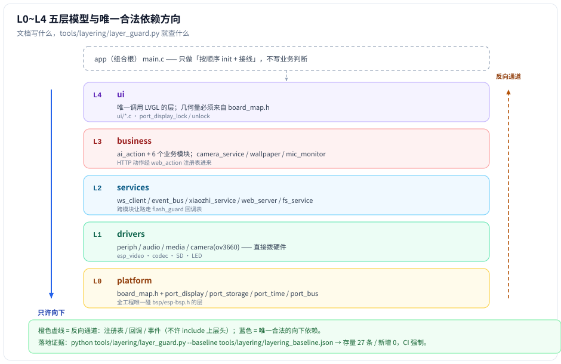

# 01 工程分层架构（五层模型）

> 本工程按 **L0 platform → L1 drivers → L2 services → L3 business → L4 ui** 五层划分。
> 上位层只能向下依赖，反向依赖必须走「注册表 / 回调 / 事件」。
> 本文与 `tools/layering/layer_guard.py` 是同一套口径：**文档写什么，脚本就查什么**。
> 2026-11-20 修订：旧版三层（app / middleware / ui）已废弃，其中 `udp_voice.c`、
> `tcp_record.c`、`ui_disp.c` 等文件早已删除，旧文档与代码脱节。

## 层号与目录映射

| 层 | 名字 | 目录 | 允许 include | 禁止 include |
|---|---|---|---|---|
| L0 | platform 平台适配 | `main/platform/` | ESP-IDF、BSP、LVGL（本层就是 LVGL port） | 任何 middleware / ui 头 |
| L1 | drivers 驱动 | `middleware/periph/*`、`audio`、`media/*`、`camera/ov3660*` | L0 platform、ESP-IDF 驱动、BSP | L2 services 以上、lvgl、ui |
| L2 | services 服务 | `middleware/net/*`（web_server、wifi_manager、net_time、screen_shot）、`fs_service`、`storage`、`media_player`、`slice_client` | L0/L1 | L3 business、lvgl、ui |
| L3 | business 业务 | `middleware/ai/ai_*`（punch/camera/music/light/speaker/device/action）、`camera_service`、`record_video`、`mic_monitor`、`wallpaper`、`companion_stats`、`net/xiaozhi_service`、`event_bus` | L0/L1/L2 | L4 ui、lvgl |
| L4 | ui 界面 | `main/ui/` | 全部下层（读服务即可） | 板级/BSP 头（几何量必须来自 `platform/board_map.h`） |
| — | app 组合根 | `main/app/main.c` | 全部（只允许「按顺序初始化」，不许写业务逻辑） | — |

`middleware/ai/` 是**逐文件**分层的：`ai_punch.c`、`ai_camera.c`、`ai_music.c`、
`ai_light.c`、`ai_speaker.c`、`ai_device.c`、`ai_action.c`、`ai_action_endpoints.c` 属 L3；
`ws_client.c`、`event_bus.c`、`xiaozhi_service.c`、`cloud_media_service.c`、`voice_service.c`、
`slice_client.c`、`music_source.c`、`music_lib.c` 属 L2。

## 依赖方向（唯一合法方向：向下）



- **L4 → L0 的唯一入口是 `platform/`**：`BOARD_LCD_H_RES/V_RES`、`BOARD_LED_RGB_GPIO`、
  `disp_start/disp_lock/disp_unlock/disp_input_dev/disp_fb_get/disp_brightness_set`、
  `storage_*`、`port_time_*`、`bus_i2c_init`。UI 里出现 `bsp/esp-bsp.h` 即违规（护栏 G2）。
- **跨模块反向依赖**（L3 内部互相 include 具体实现头）一律改为：
  注册表（固定容量静态槽，禁 malloc）、回调表（`xxx_ops_t`）、FreeRTOS 队列/事件位。

## 层间通信机制

| 方向 | 机制 | 现成例子 |
|---|---|---|
| L4 → L2/L3 | 命令队列 / 直接调服务 API | `audio_service_post_cmd(&cmd)` |
| L2/L3 → L4 | 注册表注入渲染槽 | `punch_watermark_ops_t`（`punch_watermark_ui_init()` 由 app 调） |
| L3 → L2 | 回调表 | `flash_guard_client_t{name,busy,calm,restore}` |
| HTTP → L3 | 动作注册表 | `web_action.h`（8 槽，`web_act_id_t` 为权威枚举） |
| 任意 → app | 组合根接线 | `flash_guard_wire()`、`ai_action_endpoints_init()` |

## 禁止事项

- 中间层 `#include "lvgl.h"`（`platform/port_display.h` 例外：它本身就是 LVGL port）；
- UI 直接 include `bsp/esp-bsp.h` / `esp_lcd_*` / `driver/gpio.h`（几何与引脚走 `board_map.h`）；
- 公共头（被两层以上 include 的 `.h`）暴露厂商硬件类型（`esp_codec_dev_handle_t`、
  `esp_cam_sensor_types`、`esp_lcd_panel_handle_t` 等）；
- 公共头里 `extern` 别的模块的可变全局；
- app 层写业务判断（app 只做「按顺序 init + 接线」）；
- 动态分配注册表 / 任务栈放 PSRAM（内部 RAM 内部堆约 37 KB、最大连续块 7 KB 级，任务栈必须内部 RAM）。

## 护栏（CI 强制）

```powershell
# 全量报告
python tools/layering/layer_guard.py --root . --format text
# CI 口径：只允许比基线更少，不许新增
python tools/layering/layer_guard.py --root . --baseline tools/layering/layering_baseline.json --fail-on high
# 债务减少后刷新基线（登记即承认，欠债不许变大）
python tools/layering/layer_guard.py --root . --update-baseline tools/layering/layering_baseline.json
```

规则：G1 反向依赖 / G2 UI 吃板级头 / G3 公共头漏硬件类型 / G4 中间层吃 LVGL /
G5 公共头 extern 可变全局 / G6 模块环。
编译期不生效的依赖（如 `#if CONFIG_XXX=n` 才 include 的调试探针）用
`// layer-guard:ignore <理由>` 豁免，豁免理由必须写清为什么静态扫描看不见。

## 当前存量债务（2026-11-20 基线，27 条 / 14 文件）

| 规则 | 数量 | 说明 |
|---|---|---|
| G1 | 18 | 主体是 `xiaozhi_service`(7) 与 `event_bus`(4) 直接 include `ai_*` 业务头（MCP 工具派发）；`camera_service`(3)、`web_server`(2)、`face_quality.h`(1) |
| G3 | 3 | `audio_service.h` / `mic_frontend.h` 暴露 `esp_codec_dev_handle_t`；`ov3660_fmt.h` 用 `esp_cam_sensor_types`（驱动自有头，正常） |
| G4 | 3 | `face_service.cpp`、`screen_shot.c` 含 `lvgl.h`（仅类型） |
| G5 | 2 | `fs_service.h` 的 `file_buffer` / `file_buffer_size`（壁纸双缓冲借用） |
| G6 | 1 | services 五方环：camera ↔ net ↔ media ↔ audio ↔ ai |

清偿顺序见 `docs/项目规划/分层解耦评估与优化方案_2026-11-20.md`（P2 收尾 / P3）。
